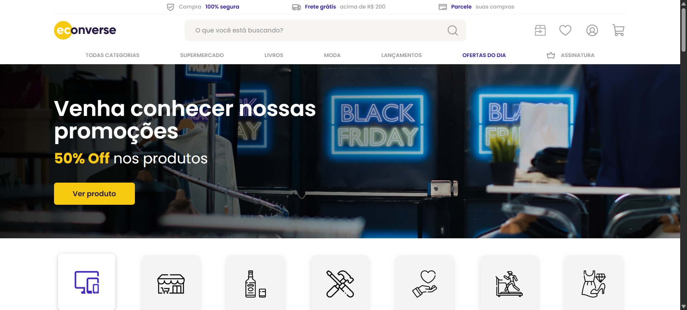
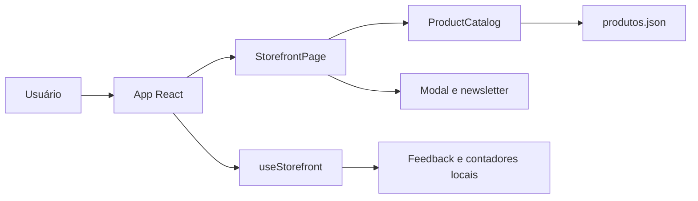
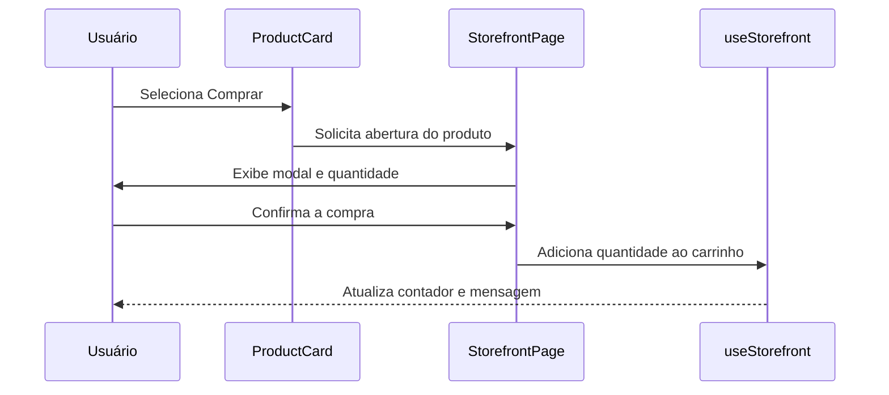

<a id="readme"></a>
<a id="inicio"></a>

<p align="center"><a href="#inicio"></a>


<a id="tecnologias"></a>

<p align="center">
<a href="#inicio"></a>
<a href="#tecnologias"></a>
<a href="#tecnologias"></a>
</p>

<p align="center">
<a href="https://skillicons.dev">
  
</a>
</p>

## Sobre o Projeto

**Uma experiência de e-commerce feita para encontrar ofertas com facilidade.**

Encontrar produtos em uma loja online deve ser simples: a navegação precisa ser clara, os preços fáceis de comparar e as ações importantes estar sempre à mão.

O Econverse é uma vitrine demonstrativa de e-commerce desenvolvida com React e Vite. A página reúne ofertas de tecnologia, navegação por categorias, prateleiras de produtos, detalhes em modal e uma área de newsletter em uma experiência responsiva.

> O projeto demonstra a interface e os principais fluxos de uma loja online. O catálogo vem de dados locais, e ações como busca, favoritos, carrinho e inscrição exibem feedback na própria página, sem integração com backend ou processamento real de pedidos.

**Experimente:** execute a aplicação localmente seguindo as instruções de instalação abaixo.

## 📦 Instalação

### Pré-requisitos

```text
Node.js >= 20.19 ou >= 22.12
npm
```

### Instalação

```bash
cd "Vaga Frontend"

npm install

npm run dev
```

Abra:

```text
http://localhost:3454
```

## ✨ O que o Projeto faz

A vitrine hoje:

| Recurso                         | O que resolve                                           | Status                    |
| ------------------------------- | ------------------------------------------------------- | ------------------------- |
| **Vitrine de ofertas**          | Destaca promoções em um banner principal                | ✅ Pronto                  |
| **Navegação por categorias**    | Apresenta categorias de produtos de forma visual        | ✅ Pronto                  |
| **Prateleiras de produtos**     | Exibe produtos relacionados, mais vendidos e ofertas    | ✅ Pronto                  |
| **Carrosséis paginados**        | Permite navegar pelos produtos em grupos de quatro      | ✅ Pronto                  |
| **Detalhes do produto**         | Abre modal com preço e controle de quantidade           | ✅ Pronto                  |
| **Carrinho demonstrativo**      | Atualiza a contagem após adicionar produtos             | ✅ Pronto                  |
| **Favoritos demonstrativos**    | Atualiza a contagem ao favoritar produtos               | ✅ Pronto                  |
| **Busca com feedback**          | Confirma o termo pesquisado na interface                | ✅ Pronto                  |
| **Newsletter**                  | Valida nome, e-mail e aceite dos termos                 | ✅ Pronto                  |
| **SEO e dados estruturados**    | Inclui metadados e marcação Schema.org para produtos    | ✅ Pronto                  |
| **Integração com loja e pagamentos** | Processar pedidos e pagamentos reais               | 🗺️ Não implementado       |

<details>
<summary><strong>📋 Ver todos os recursos</strong></summary>

### Seções da página

* Cabeçalho com busca, atalhos de conta e navegação principal
* Banner de ofertas com chamada para os produtos
* Categorias de compra
* Prateleiras de produtos relacionados, mais vendidos e ofertas do dia
* Banners de parceiros e navegação por marcas
* Formulário de inscrição na newsletter
* Rodapé com links institucionais e redes sociais

### Produtos em destaque

* **Tecnologia**: catálogo local com 10 produtos de exemplo, preços em centavos e imagens carregadas da fonte de dados do projeto
* **Prateleiras**: produtos relacionados, mais vendidos e ofertas do dia usam o mesmo catálogo demonstrativo
* **Detalhes**: modal com preço formatado em reais e seleção de quantidade antes de adicionar ao carrinho

### Experiência

* Layout responsivo com estilos em CSS e Sass
* Carrossel com navegação circular em páginas de quatro produtos
* Modal que fecha pelo botão, pelo clique fora ou pela tecla `Escape`
* Controles acessíveis com rótulos, estados selecionados e mensagens de status
* Dados estruturados Schema.org para a organização, o site e os produtos

</details>

## 🎬 Demonstração

<p align="center">
  
</p>


<div style="display:flex;gap:14px;border-left:4px solid hsl(224 75% 50%);padding:12px 16px;border-radius:6px;background:transparent;align-items:flex-start">
  <div style="flex:0 0 44px;display:flex;align-items:center;justify-content:center">
    <div style="width:36px;height:36px;border-radius:8px;background:hsl(224 75% 95%);display:flex;align-items:center;justify-content:center;color:hsl(224 75% 50%);font-weight:700">
      <svg xmlns="http://www.w3.org/2000/svg" width="18" height="18" viewBox="0 0 24 24" fill="none" stroke="hsl(224 75% 50%)" stroke-width="2" stroke-linecap="round" stroke-linejoin="round" aria-hidden="true"><rect x="3" y="3" width="18" height="18" rx="2" ry="2"></rect><path d="M12 8v4"></path><path d="M12 16h.01"></path></svg>
    </div>
  </div>
  <div style="min-width:0">
    <div style="font-weight:600;color:hsl(224 75% 46%);margin-bottom:4px">Importante</div>
    <div>Esta é uma demonstração de frontend. Busca, favoritos, carrinho e newsletter não persistem dados nem se comunicam com serviços externos. O catálogo é carregado de <code>src/data/produtos.json</code>.</div>
  </div>
</div>

## 🚀 Primeiros Passos

### 1. Explore a vitrine

Comece pelo banner de ofertas e percorra as categorias disponíveis no início da página.

### 2. Navegue pelos produtos

Use as setas das prateleiras para avançar ou voltar entre os grupos de produtos.

### 3. Abra os detalhes

Selecione um produto para consultar o modal, ajustar a quantidade e adicioná-lo ao carrinho demonstrativo.

### 4. Experimente as ações

Teste a busca, os favoritos e o formulário de newsletter para visualizar as mensagens de feedback.

A partir daí:

```text
Explorar o banner e as categorias
    ↓
Navegar pelas prateleiras de produtos
    ↓
Abrir detalhes e selecionar a quantidade
    ↓
Adicionar ao carrinho demonstrativo
    ↓
Experimentar busca e newsletter
```

## 🧠 Como Funciona

Os produtos são mantidos em `src/data/produtos.json` e importados pelo módulo `src/data/storefront.ts`:

```json
{
  "success": true,
  "products": [
    {
      "productName": "Iphone 11 PRO MAX BRANCO 1",
      "descriptionShort": "Iphone 11 PRO MAX BRANCO 1",
      "photo": "https://app.econverse.com.br/teste-front-end/junior/tecnologia/fotos-produtos/foto-iphone.png",
      "price": 15000
    }
  ]
}
```

O módulo de dados expõe os produtos, o tipo inferido e uma função para formatar os preços em reais:

```ts
import productData from "./produtos.json"

export const products = productData.products
export type Product = (typeof products)[number]

export const formatPrice = (price: number) =>
  new Intl.NumberFormat("pt-BR", {
    style: "currency",
    currency: "BRL",
  }).format(price / 100)
```

O hook `useStorefront` controla o estado local do carrinho, dos favoritos, das mensagens e do produto selecionado. Os componentes montam as seções da página e geram os dados estruturados dos produtos:



<details>
<summary><strong>🏗️ Detalhes da arquitetura</strong></summary>

### Componentes

| Componente                         | Responsabilidade                              |
| ---------------------------------- | --------------------------------------------- |
| `src/App.tsx`                      | Conecta o hook de estado à página             |
| `src/components/StorefrontPage.tsx`| Monta cabeçalho, seções, modal e rodapé       |
| `src/components/ProductCatalog.tsx`| Renderiza prateleiras, cartões e Schema.org   |
| `src/hooks/useStorefront.ts`        | Mantém contadores, mensagens e produto ativo  |
| `src/data/storefront.ts`            | Expõe produtos, tipos e formatação de preço  |
| `src/data/produtos.json`            | Catálogo local de produtos                    |
| `src/index.css` e `src/styles.scss` | Estilos globais e da vitrine                  |

### Fluxo de uma interação de compra



### Decisão: React 19 + Vite 8

React organiza a interface em componentes e mantém o estado interativo da página. Vite fornece o servidor de desenvolvimento e o processo de build configurado para o projeto.

### Decisão: catálogo local em JSON

O catálogo em JSON mantém os dados de demonstração separados da interface. Isso facilita editar os produtos sem introduzir uma API ou dependência de backend para executar a vitrine.

</details>

<a id="estrutura-do-projeto"></a>

## 🗂️ Estrutura do Projeto

```text
Vaga Frontend/
├── public/
│   ├── assets/
│   ├── fonts/
│   ├── favicon.ico
│   └── robots.txt
├── src/
│   ├── components/
│   │   ├── ProductCatalog.tsx
│   │   └── StorefrontPage.tsx
│   ├── data/
│   │   ├── produtos.json
│   │   └── storefront.ts
│   ├── hooks/
│   │   └── useStorefront.ts
│   ├── App.tsx
│   ├── index.css
│   ├── main.tsx
│   └── styles.scss
├── exemplo.md
├── index.html
├── package.json
├── tsconfig.json
└── vite.config.ts
```

<details>
<summary><strong>📁 Explicação da estrutura</strong></summary>

| Caminho                 | Objetivo                                           |
| ----------------------- | -------------------------------------------------- |
| `public/assets`         | Imagens, logotipos e ícones da vitrine             |
| `public/fonts`          | Fontes estáticas                                   |
| `src/components`        | Página da loja e componentes de catálogo           |
| `src/data`              | Catálogo local e funções de domínio dos produtos   |
| `src/hooks`             | Estado e ações da vitrine                          |
| `src/App.tsx`            | Composição da aplicação                            |
| `src/main.tsx`           | Ponto de entrada React                             |
| `src/index.css`          | Estilos CSS globais                                |
| `src/styles.scss`        | Estilos Sass da aplicação                          |
| `index.html`             | Metadados, dados estruturados e elemento raiz      |
| `vite.config.ts`         | Plugins e configuração do servidor Vite            |

### Arquitetura

A aplicação separa a apresentação, o estado local e os dados do catálogo:

| Camada              | Diretórios/arquivos                     | Responsabilidade                         |
| ------------------- | --------------------------------------- | ---------------------------------------- |
| **Apresentação**    | `src/components`, `src/App.tsx`          | Interface e composição das seções        |
| **Estado**          | `src/hooks/useStorefront.ts`             | Seleção, feedback e contadores locais     |
| **Dados**           | `src/data`                               | Produtos e formatação de valores          |
| **Estilos**         | `src/index.css`, `src/styles.scss`        | Aparência e layout responsivo             |
| **Documento**       | `index.html`                             | Metadados e entrada da aplicação          |

**Por que essa arquitetura?**

- **Manutenibilidade**: catálogo e interface ficam em arquivos separados.
- **Simplicidade**: o hook concentra o estado das interações demonstrativas.
- **Reutilização**: prateleiras compartilham os mesmos cartões e dados de produto.
- **Evolução**: os dados locais podem ser substituídos por uma API quando houver backend.

</details>

## ⚙️ Configurações Avançadas

<details>
<summary><strong>🔧 Configurações do Vite</strong></summary>

| Configuração       | Onde definir       | Descrição                         | Exemplo       |
| ------------------ | ------------------ | --------------------------------- | ------------- |
| `server.port`      | `vite.config.ts`   | Porta do servidor de desenvolvimento | `3454`      |
| `server.open`      | `vite.config.ts`   | Abre o navegador ao iniciar       | `true`        |
| `scripts.dev`      | `package.json`     | Inicia o servidor de desenvolvimento | `vite`      |
| `scripts.build`    | `package.json`     | Gera o build de produção           | `vite build`  |
| `scripts.preview`  | `package.json`     | Visualiza o build localmente       | `vite preview`|
| `scripts.format`   | `package.json`     | Formata arquivos com Oxfmt         | `oxfmt`       |

</details>

<details>
<summary><strong>🧪 Build e execução</strong></summary>

Build de produção:

```bash
npm run build
```

Preview do build:

```bash
npm run preview
```

Servidor de desenvolvimento:

```bash
npm run dev
```

Formatação:

```bash
npm run format
```

</details>

## 📚 Documentação

| Documento                         | Descrição                              |
| --------------------------------- | -------------------------------------- |
| [README](./README.md)              | Visão geral e instruções do projeto    |
| [Exemplo de estrutura](./exemplo.md)| Modelo usado como referência           |
| [package.json](./package.json)     | Dependências e scripts disponíveis     |
| [Catálogo de produtos](./src/data/produtos.json) | Dados locais da vitrine       |
| [robots.txt](./public/robots.txt)  | Regras para crawlers                    |

## 🤝 Contribuindo

Contribuições são bem-vindas: correções, melhorias de acessibilidade, ajustes de responsividade e documentação.

1. Faça um fork do projeto
2. Crie sua branch (`git checkout -b feature/minha-melhoria`)
3. Faça commit das alterações (`git commit -m 'Adiciona minha melhoria'`)
4. Envie a branch (`git push origin feature/minha-melhoria`)
5. Abra um Pull Request

## 📜 Licença

O repositório não declara uma licença de uso. Consulte os responsáveis pelo projeto antes de reutilizar o código ou os assets.

## 💙 Agradecimentos

Obrigado a quem explora a vitrine e contribui com sugestões e melhorias. Este projeto utiliza React, Vite, TypeScript, Sass e ferramentas open source do ecossistema JavaScript.

<div align="center">

  

  <p><em>Uma vitrine digital para descobrir ofertas. Feito por Carlos Neto</em></p>

  <p>
    <a href="#inicio"></a>
    <a href="https://img.shields.io/badge/React-19-149eca?style=flat-square&logo=react"></a>
  </p>

  <p>
    <a href="#estrutura-do-projeto">Código e estrutura</a> •
    <a href="#inicio">Vitrine</a>
  </p>

  <p><a href="#readme">⬆ Voltar ao topo</a></p>

</div>